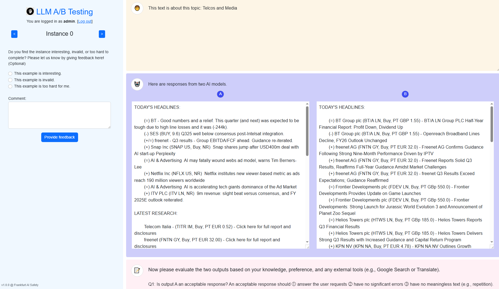

# Human Evaluation Annotation Interface

This folder contains the code for the human eval annotation interface used in the paper [How Far Can Camels Go? Exploring the State of Instruction Tuning on Open Resources](https://arxiv.org/abs/2306.04751).

## Installation

```bash
conda create -n human_eval python=3.11
conda activate human_eval
pip install -r requirements.txt
```

## Running the Interface

Before running the app, you need to put evaluation instance in the `data` folder. Each instance should have a prompt and two completions from two different models. We provide an example in `data/eval_instances_tulu_1.jsonl`.

Each line of this file should be in the following format:

```json
{
    "id": "unique instance id",
    "prompt": "prompt text",
    "completions": [
        {
            "model": "model 1 name",
            "completion": "completion text"
        },
        {
            "model": "model 2 name",
            "completion": "completion text"
        }
    ]
}
```

The `id` field is required: it is stored with every submitted annotation and is used to group
repeated annotations of the same instance when computing agreement.

### Configuration and secrets

The app is configured through environment variables. Nothing sensitive is stored in the code.

| Variable | Required | Purpose |
| --- | --- | --- |
| `SECRET_KEY` | Recommended | Signs Flask session cookies. If unset, a random key is generated at startup, which invalidates sessions on every restart. Must be set in any real deployment. |
| `SIGNUP_TOKEN` | Optional | Registration token. **If unset, `/signup` returns 404 and no new accounts can be created.** |
| `ADMIN_PASSWORD` | On first run | Password for the initial `admin` account. The app refuses to start rather than fall back to a default password. |
| `DATA_PATH` | Optional | Directory holding `evaluation.db`. Defaults to `./data`. |
| `COMPARISON_DATA_PATH` | Under gunicorn | Path to the instances `.jsonl`. Only needed when the app is imported by a WSGI server; `python app.py` uses `--comparison_data_path` instead. |
| `EVALUATION_QUESTIONS_PATH` | Optional | Path to the JSON file containing evaluator-facing question text. Defaults to `./evaluation_questions.json`. The file is read and validated at startup. |

### Evaluation questions

Evaluator-facing questions live in [`evaluation_questions.json`](evaluation_questions.json). Edit the text values there to rephrase the interface, then restart the app. The answer controls and stored answer values are intentionally not configured, so rewording questions does not change exports or metric processing. Set `EVALUATION_QUESTIONS_PATH` to use a configuration file elsewhere.

Generate values with:

```bash
python -c "import secrets; print(secrets.token_hex(32))"     # SECRET_KEY
python -c "import secrets; print(secrets.token_urlsafe(24))" # SIGNUP_TOKEN
```

Now you can run the app with:
```bash
SECRET_KEY=... SIGNUP_TOKEN=... ADMIN_PASSWORD=... \
    python app.py --comparison_data_path data/your_data_file.jsonl --host 0.0.0.0 --port 5001
```

Or, in debug mode:
```bash
python app.py --comparison_data_path data/your_data_file.jsonl --host 0.0.0.0 --port 5001 --debug
```

For local testing there are two helper scripts. Both set the same throwaway credentials
(`admin` / `admin`, signup token `dev-signup-token`) and serve on `127.0.0.1:5001`.

`run_local.sh` runs the Flask development server, which supports `--debug` and reloads on change:

```bash
./run_local.sh                                          # defaults
DATA_FILE=data/eval_instances_tulu_1.jsonl ./run_local.sh
PORT=8080 ./run_local.sh --debug
```

`run_gunicorn_local.sh` runs gunicorn exactly as the container does, so use it to check anything
that depends on the production server rather than the dev one:

```bash
./run_gunicorn_local.sh                                 # defaults
DATA_FILE=data/eval_instances_tulu_1.jsonl ./run_gunicorn_local.sh
PORT=8080 WORKERS=1 THREADS=8 ./run_gunicorn_local.sh
./run_gunicorn_local.sh --reload                        # extra flags pass through to gunicorn
```

It defaults to `data/eval_instances.jsonl` (the file the image loads) rather than the
`_mm_base` file used by `run_local.sh`. It picks an interpreter in this order: an explicit
`PYTHON=`, an activated virtualenv, then `./.venv`, and it fails with an install hint if gunicorn
is missing from the one it chose.

### Serving in production

`python app.py` starts the Flask development server, which is fine for local work but should not
face real annotators. The container image instead runs gunicorn, which imports the app as a module
and therefore reads `COMPARISON_DATA_PATH` from the environment:

```bash
SECRET_KEY=... ADMIN_PASSWORD=... COMPARISON_DATA_PATH=data/your_data_file.jsonl \
    gunicorn --bind 0.0.0.0:5001 --workers 1 --threads 8 --timeout 120 app:app
```

Locally, `./run_gunicorn_local.sh` wraps this same command with development credentials.

**Keep `--workers 1`.** The SQLite database is stored on a Cloud Storage FUSE mount, which provides
no POSIX file locking and uploads a whole object when the file is closed. A second worker process
would be a second independent writer to that object, and the loser of the race silently loses its
annotations. For the same reason the deployment is pinned to `--max-instances=1`, and SQLAlchemy is
configured with `NullPool` so each request closes the database file and the commit actually reaches
the bucket. Threads are safe: they share one process and SQLite serialises them internally.

If you ever need more than one worker or instance, move the database to Cloud SQL — only
`SQLALCHEMY_DATABASE_URI` has to change.

### Randomisation

Two things are randomised so that annotators are not biased by presentation:

- **Which side each model appears on** is re-drawn on every request, so model A is equally likely to
  be shown left or right. The submitted record stores the model names as displayed, so the data
  stays correct regardless. Note that revisiting an instance may show the two sides swapped.
- **The order instances are presented in** is a per-user permutation derived deterministically from
  the username, so two annotators do not walk the corpus in the same sequence, but each annotator's
  own sequence is stable across sessions and restarts.

Because of the second point, the integer in `/instances/<position>` is a position within *that user's*
ordering, not a global instance number. The API returns the global index alongside the content, and
that is what gets written to `instance_index` in the database, so exports and metrics remain
comparable across users. A consequence worth planning for: independent permutations mean annotators
overlap on the same instance only by chance, so inter-annotator agreement statistics accumulate
slowly.

### Accounts

The `admin` account is created once, on the first run, when `data/evaluation.db` does not yet exist.
Changing `ADMIN_PASSWORD` afterwards does not update the existing account.

Other annotators register themselves: click **Switch to Signup** and supply the username, a password
of at least 8 characters, and the registration token you share with them. Leave `SIGNUP_TOKEN` unset
to disable registration entirely once everyone is onboarded.

You can open the app in your browser at http://localhost:5001. When doing the annotation, you can track the progress at the following url: http://localhost:5001/summary.

### Endpoints

| Endpoint | Method | Auth | Description |
| --- | --- | --- | --- |
| `/` | GET | – | Redirects to the first instance, or to the login page |
| `/login` | GET, POST | – | Login form and submission |
| `/signup` | GET, POST | Registration token | Account creation; 404 when `SIGNUP_TOKEN` is unset |
| `/logout` | GET | Session | Logs the current user out |
| `/instances/<position>` | GET | – | Annotation interface for one instance, by position in the user's ordering |
| `/api/model-outputs/<position>` | GET | – | Prompt and completions for that position; sides randomised, returns the global `instance_index` |
| `/api/submit-evaluation` | POST | Session | Stores an acceptance/preference annotation |
| `/api/submit-feedback` | POST | Session | Stores instance-quality feedback and comments |
| `/summary` | GET | Session | Progress, contributions and agreement metrics as JSON |
| `/export_results` | GET | Session | Downloads all annotations as an `.xlsx` file |

Here is a screenshot of the annotation interface:

<center>

   

</center>

## Post-processing and Analysis

The annotation results are saved in a database file `data/evaluation.db` by default. You can use the following command to export the results to an excel file:

```bash
python export_db.py data/eval_annotations.xlsx
```

Then, you can use the following command to compute the evaluation metrics and agreements:

```bash
python compute_metrics.py data/eval_annotations.xlsx
```

This generates the metrics JSON file and two Matplotlib charts:

```text
data/eval_annotations_results.json
data/eval_annotations_acceptance_rates.png
data/eval_annotations_comparison_preferences.png
```

## Tests

To run the unit tests, type:
```bash
pytest -v tests/human_eval_tests.py
```

The tests are self-contained: they run against a fresh in-memory SQLite database and never touch
`data/evaluation.db`.

## Deployment

The workflow in `.github/workflows/compile_and_test_gcp.yaml` runs the unit tests, builds the
container and pushes it to Artifact Registry. Deployment to Cloud Run is a separate, opt-in stage.

| Stage | When it runs |
| --- | --- |
| Test, build, push | Every push to `master` |
| Deploy to Cloud Run | Only when a pushed commit message contains `[deploy]`, or when a pull request is merged |

The deploy step mounts a Cloud Storage bucket at `/mnt/gcs` using Cloud Storage FUSE. The image
symlinks `/app/data` to `/mnt/gcs/human-evaluation`, so `evaluation.db` lives in the bucket and
survives restarts and scale-to-zero. The service runs with `--max-instances=1`, because SQLite over
Cloud Storage FUSE is not safe to write from several instances at once, and with
`--allow-unauthenticated`, so the application login is the only access control.

Cloud Run resource settings are pinned in CI/CD: `--memory=2Gi`, `--cpu=2`, and
`--concurrency=16`.

The following repository/environment secrets must be defined in the `docker-env` GitHub environment:

| Secret | Purpose |
| --- | --- |
| `GCP_SA_KEY` | Service account key used to authenticate to Google Cloud |
| `GCP_PROJECT` | Target Google Cloud project |
| `GCS_BUCKET` | Bucket mounted at `/mnt/gcs` (bucket name only, without the `human-evaluation` folder) |
| `SECRET_KEY` | Flask session signing key |
| `SIGNUP_TOKEN` | Registration token handed to annotators |
| `ADMIN_PASSWORD` | Password of the initial `admin` account |

The deploy step fails fast if `GCS_BUCKET`, `SECRET_KEY` or `ADMIN_PASSWORD` is missing. The Cloud
Run service identity is set explicitly to
`cicd-sa@steel-wall-436909-g7.iam.gserviceaccount.com` and needs object-level write permissions on
the bucket (for example `roles/storage.objectAdmin`).

### Deployment troubleshooting

If deploy succeeds but the service cannot read/write the bucket, verify runtime identity and IAM:

```bash
PROJECT_ID=steel-wall-436909-g7
SERVICE_NAME=human-eval-service
REGION=us-central1
BUCKET=ai-safety-bucket
RUNTIME_SA=cicd-sa@steel-wall-436909-g7.iam.gserviceaccount.com

# 1) Confirm the service runtime account
gcloud run services describe "$SERVICE_NAME" \
    --region="$REGION" --project="$PROJECT_ID" \
    --format='value(spec.template.spec.serviceAccountName)'

# 2) Confirm the bucket exists and is reachable
gcloud storage buckets describe "gs://$BUCKET"

# 3) Check IAM bindings for the runtime SA on the bucket
gcloud storage buckets get-iam-policy "gs://$BUCKET" --format=json | \
    jq '.bindings[] | select(.members[]? == "serviceAccount:'"$RUNTIME_SA"'")'

# 4) Grant write access (run as a project/bucket admin account)
gcloud storage buckets add-iam-policy-binding "gs://$BUCKET" \
    --member="serviceAccount:$RUNTIME_SA" \
    --role="roles/storage.objectAdmin"
```

If `add-iam-policy-binding` fails with `storage.buckets.getIamPolicy denied`, the active account
does not have permission to edit bucket IAM. Switch to a project/bucket admin account and rerun.

## Notes

- The application version is defined by `APP_VERSION` in `app.py` and shown in the bottom-left corner of the interface
- This repository is derived from [Allen AI's Open Instruct project](https://github.com/allenai/open-instruct) (`human_eval`)
- The original license is Apache 2.0
- To build the container, check its [Docker](DOCKER.md) documentation
